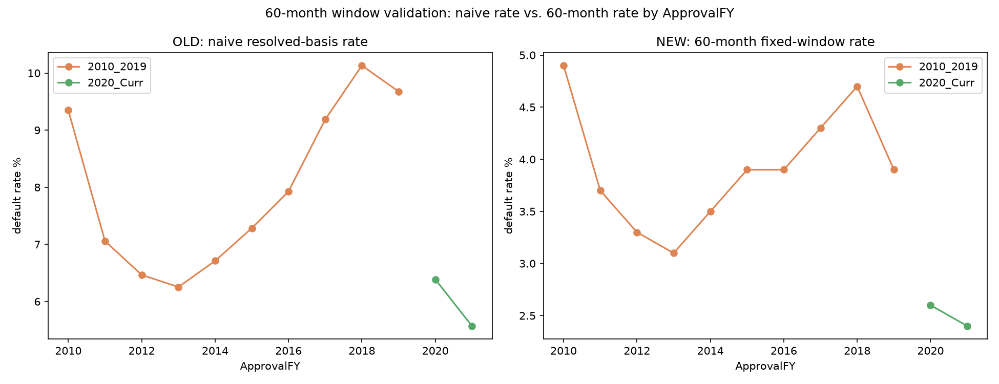
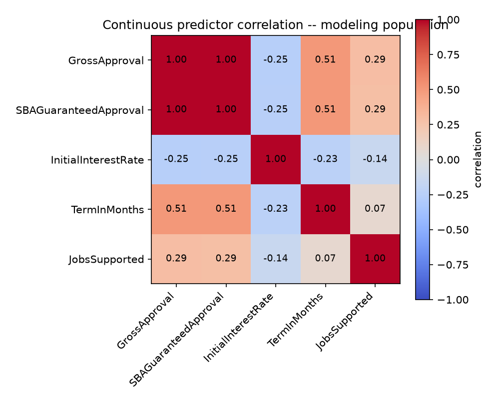
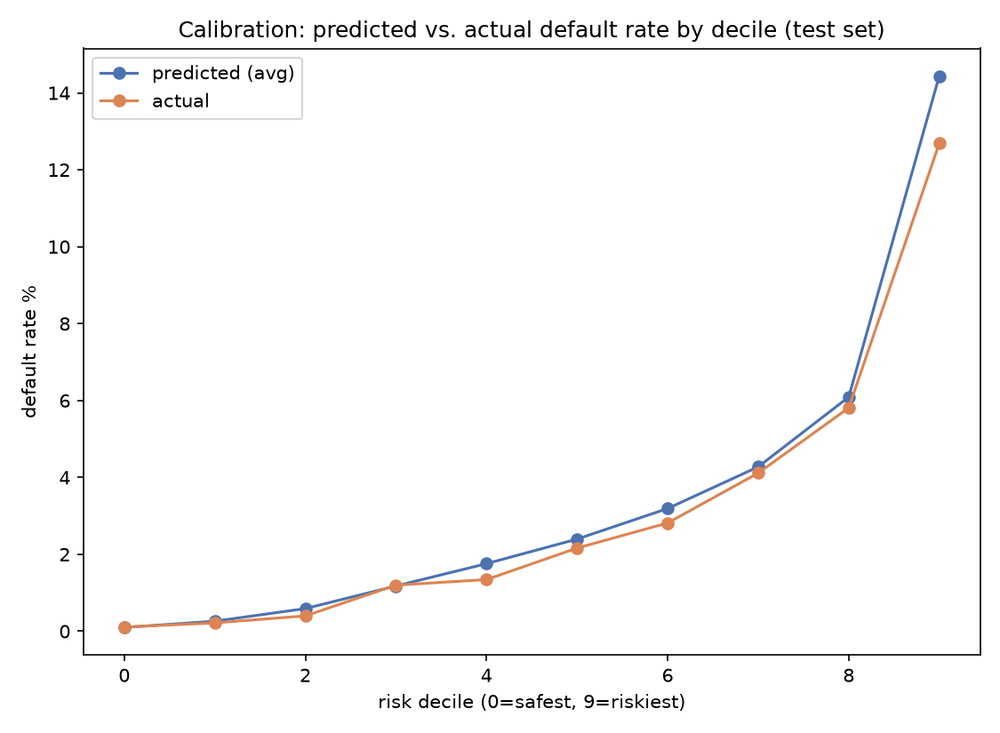
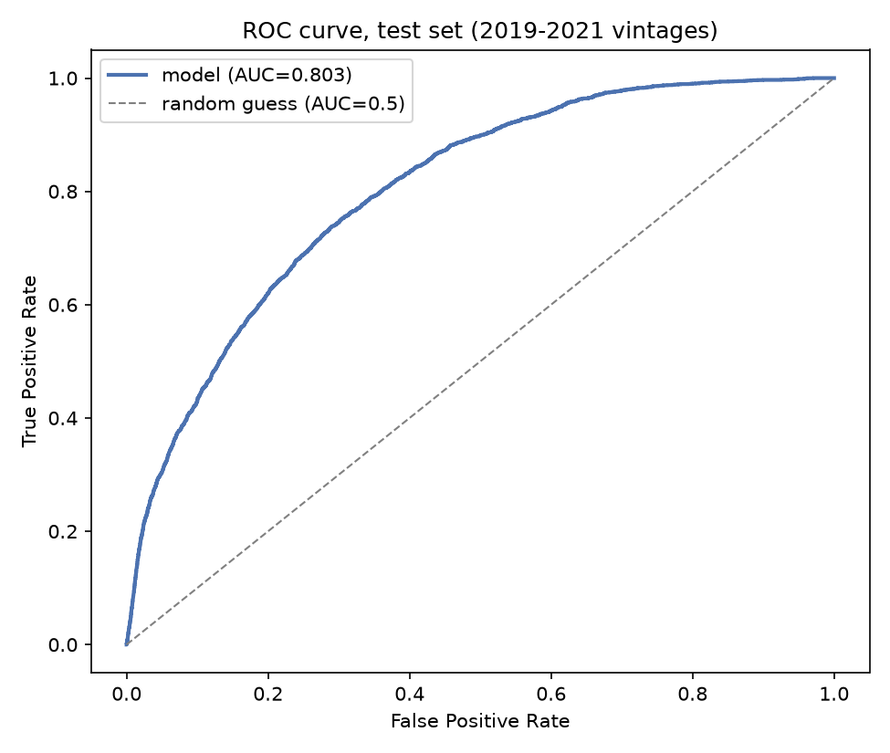
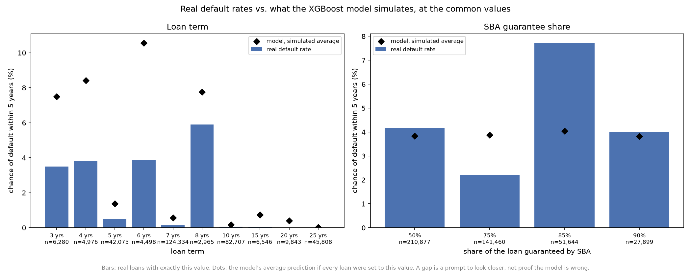
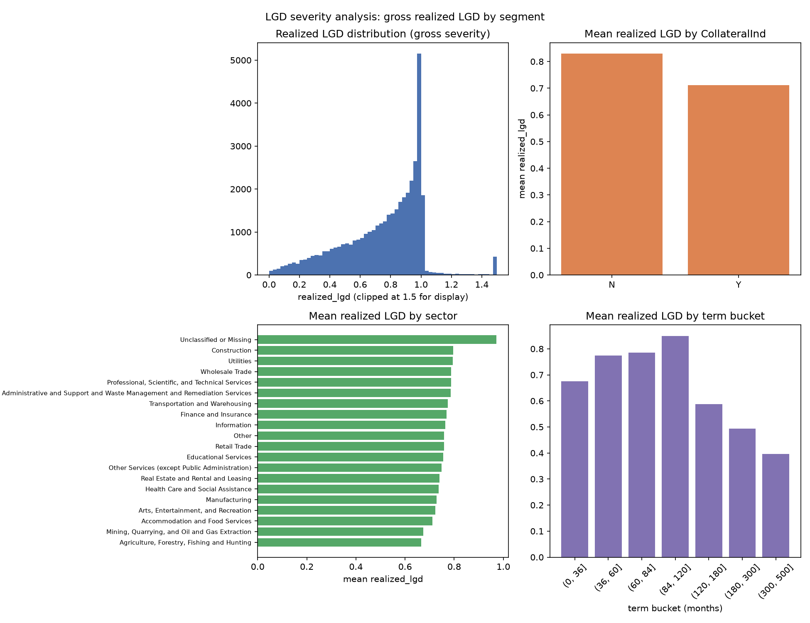
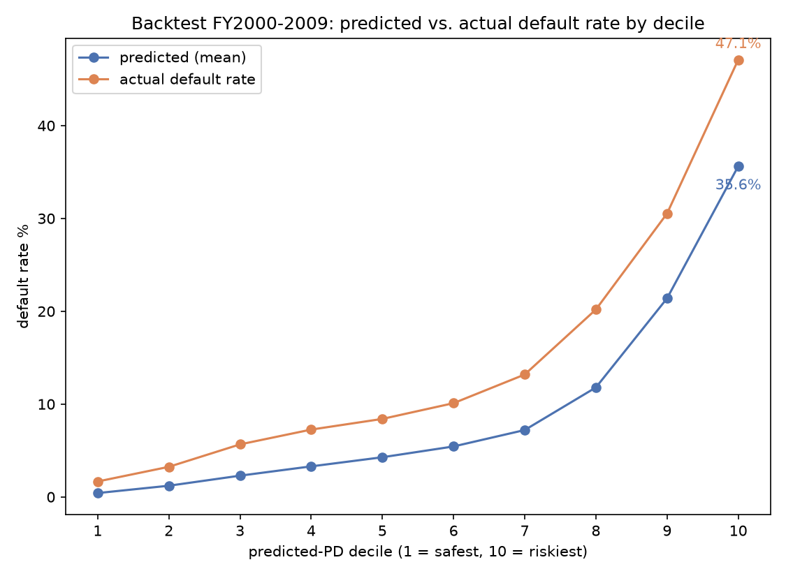
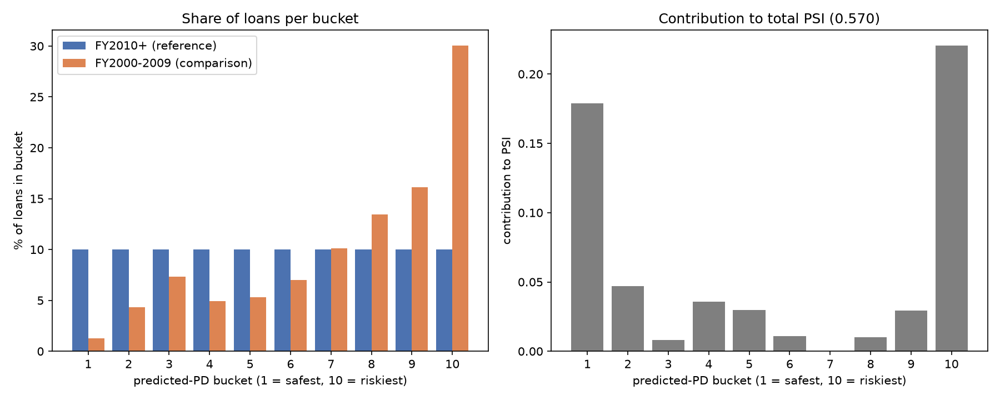
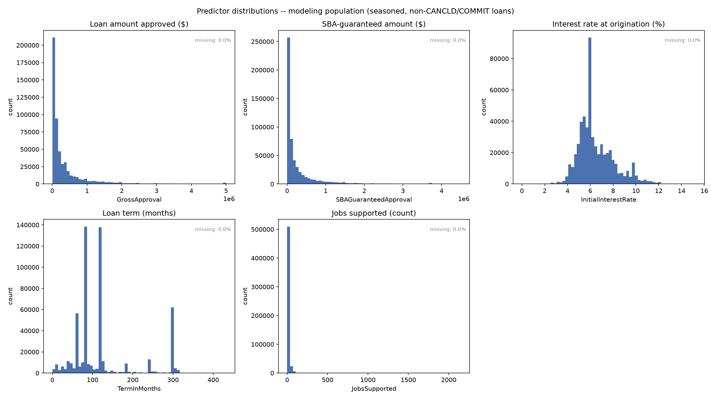
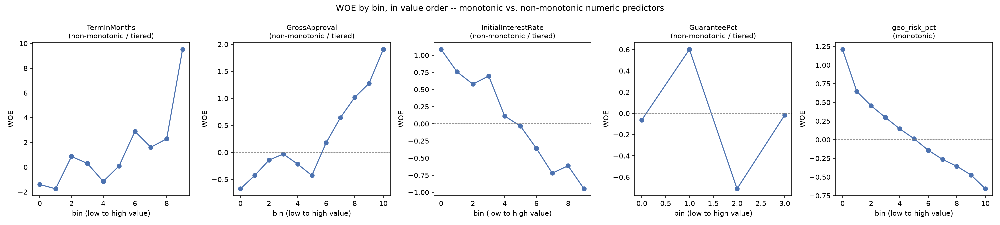

# PD/LGD/EAD Credit Risk Model for US SME Loans

*A reproducible reference PD/LGD/EAD model for US SME lending, built on SBA 7(a) FOIA loan-level data.*

---

# The Problem This Project Speaks To

Credit risk modeling for small and medium-sized businesses (SMEs) is a well-understood problem inside banks and lending institutions — and almost entirely invisible outside them. Real SME PD models are proprietary, built on private loan books, and never published in a form that shows how they actually perform on real, messy, loan-level data. What does reach the public are toy examples: clean, well-documented consumer credit datasets (Lending Club and similar) that bear little resemblance to the SME lending problem, or academic papers that describe a methodology without a working, reproducible implementation attached to it. This project builds a transparent, reproducible reference implementation instead — a full PD/LGD/EAD pipeline on real, publicly available SME loan data, with a fully reproducible codebase and every result independently checkable.

This project is also grounded in direct industry experience, not built as a purely academic exercise: the author previously used origination data with nearly 800 features to design and build a bespoke credit risk framework in fintech — informing a practitioner's sense of what a real credit-risk workflow needs from a model like this one, not just what looks good in a research paper.

## What this project is, and isn't, meant to be used for

The intended use is narrow: a transparent, reproducible reference PD/LGD/EL estimate for a prospective US SME 7(a)-style loan at origination, not a replacement for full underwriting-grade scoring. Variables a real underwriting decision would weigh — credit score, DSCR, leverage, collateral valuation, payment history — are structurally absent from this data, a property of the FOIA disclosure, not this project's design. This shapes what kind of model the data can support: an origination-time, statistical model built from loan and program characteristics, not a full underwriting-grade or behavioral scoring model.

---

# Methodology

## Data source and scope

The SBA 7(a) program is the SBA's flagship small-business loan guarantee: approved private lenders originate and underwrite each loan, and the SBA guarantees a portion of it (roughly 50–90%) to reduce the lender's exposure. This project uses SBA 7(a) loan-level data obtained through FOIA disclosure (data.sba.gov), covering three files: FY2000–2009, FY2010–2019, and FY2020–present. The 504 loan program is absent from the data by construction, so no separate exclusion logic was needed — every loan analyzed here is a 7(a) loan. The files cover the 2001 downturn, the 2008 financial crisis and the COVID-era disruption, which allows PD to be checked across different economic cycles rather than a single snapshot.

The data is a historical snapshot — loan amount, term, rate, industry, geography, program type and final status — with no borrower financial statements, credit score, debt-service coverage, existing leverage, collateral valuation or payment history after origination.

Combining three files spanning 2000–present required a compatibility check, not an assumption: the FY2000–2009 file was verified to have identical columns, matching field encodings, and the same granularity of business-age categorization used in FY2010–2019 (rather than the coarser scheme introduced in 2018). Including it extends the dataset back through the 2008 recession, essential for showing how PD shifts across economic cycles rather than reporting a single static estimate.

## Data validation

- Since aggregate statistics can hide row-level errors that only row-level inspection catches, this project checks values of categorical columns to ensure they align with the data dictionary description. This revealed that RevolverStatus is recorded as Y/N, not the documented 0/1. A separate check for fully duplicated rows (exact matches across every field) found roughly 1,800 across the three files.
- Every file's row count was validated against a direct read of the raw source file, categorical fields were normalized for whitespace and casing inconsistencies before use, and cross-field consistency checks (e.g., a resolution date that predates a loan's approval date) were used to identify and remove a small number of structurally invalid rows.

## Target definition and population scope

The modeling target is binary: a loan is labeled a default (1) if its status resolves to Charged Off (CHGOFF), and a non-default (0) if it resolves to Paid in Full (PIF). Loans that were cancelled before disbursement (CANCLD) never carried real repayment risk and are excluded from the target population entirely, as are loans still in the approval pipeline (COMMIT). Loans that are disbursed but not yet resolved as of the data snapshot (EXEMPT) are not excluded by category — they are eligible to enter the modeling population once they are old enough to be judged fairly, under the methodology described next. The resulting modeling population is 543,123 loans (432,991 for training and 110,132 for testing).

## The 60-month window: correcting for right-censoring

The most consequential methodological finding in this project concerns how "default rate" is measured. A naive approach — charge-off rate among already-resolved loans (CHGOFF ÷ CHGOFF+PIF) at a fixed snapshot date — is not comparable across loan vintages. Charged-off loans resolve faster on average than paid-in-full loans, so among a recent vintage's resolved loans, fast failures are over-represented while slower-paying loans are still open. Recent vintages therefore look riskier than they are — a timing artifact, not a change in credit quality. This was confirmed to be structural rather than a real economic signal: the same rise-then-crash pattern appears at the tail of every one of the three files, including the most recent one, where no recession explains it.

Two fixes were considered: adding vintage or cycle to the model as a control variable, or giving every loan the same fixed observation window. The second was used. Each loan is asked one question — did it charge off within 60 months of approval? — and a loan enters the modeling population only once it has had a full 60 months of history; younger loans are set aside. Because every loan is judged over the same 60 months, default rates are comparable across vintages.

This was validated directly. In the most recent file (FY2020 onward), the naive rate swung from 6.4% for FY2020 loans to 17.4% for FY2023 loans and to near zero for FY2026 loans, purely from timing. The 60-month rate can only be measured for vintages old enough to have a full 60 months (FY2020–2021), and there it is stable at 2.6% and 2.4%. Across FY2010–2019 the 60-month rate ranges from 3.1% to 4.9%, against 6.3% to 10.1% for the naive rate. This fix is what makes this paper's central claim — that PD shifts across economic cycles — trustworthy rather than an artifact of measurement timing.

## Feature engineering

Continuous and ordinal features were transformed using Weight-of-Evidence (WOE) binning, custom-built rather than using an off-the-shelf library (e.g. `optbinning`). The choice was about keeping control over the binning logic itself: the exact bin-merging rule (an event-count floor combined with a statistical significance test) stays fully explicit and auditable, rather than a third-party library's internal optimization logic quietly making that call for a core modeling decision.

**Everything learned from outcomes uses training years only.** The bin boundaries, the information-value screening that decided which features to keep, and any feature built from outcomes were all computed from loans approved in FY2018 or earlier, then applied to every loan, so no FY2019–2021 outcome feeds into any score.

Two engineered features replace redundant or overlapping raw fields:
- **GuaranteePct**, the ratio of SBA-guaranteed amount to gross approval amount, replaces the raw guaranteed-dollar-amount field, which is redundant with loan size (correlation of 1.00).
- **geo_risk_pct**, a single geographic risk score built in two levels. Geography can be measured coarsely (by state) or finely (by the first three digits of a zip code), and each has a trade-off: state-level rates are reliable but blunt, while zip-level rates are sharper but often based on too few loans to trust on their own. `geo_risk_pct` resolves this by using a zip-level rate whenever a zip has enough loan history to support it (at least 30 loans), and falling back to the broader state-level rate otherwise — one clean signal that is as precise as the data allows, without the redundancy and instability of feeding a state rate and a zip rate in separately.

## Model design and validation

The primary model is a logistic regression fit on WOE-transformed features, evaluated against a gradient-boosted tree ensemble (XGBoost) trained on raw feature values — a comparison between an interpretable linear model and a more flexible, non-linear ensemble. XGBoost does not require WOE transformation — tree splits evaluate one feature at a time and are scale-invariant, so feeding it WOE values would only discard the fine-grained cutoffs a tree can otherwise discover on its own.

The train/test split is time-based, not random: the model is trained on loans approved in FY2010–2018 and evaluated on FY2019–2021, held out entirely from training. A random split would let the model see loans from the same vintage-cycle it is tested on, overstating how well it would perform on genuinely new, future loans — the same reasoning behind the 60-month window above.

Validation goes beyond a single headline metric. Discrimination is reported via AUC and the Kolmogorov-Smirnov (KS) statistic; calibration is checked directly (predicted versus actual default rate by risk decile); and the Population Stability Index (PSI) is used to test how much the model's score distribution shifts across a genuinely different economic regime (the FY2000–2009 backtest, described in the Findings section). This combination — leading with calibration and population stability rather than treating AUC in isolation — is deliberately chosen to reflect practitioner-grade validation rather than a classification-accuracy exercise.

## LGD and EAD

Loss Given Default is measured directly from realized outcomes rather than a proxy: `realized_lgd = GrossChargeOffAmount / GrossApproval` for every charged-off loan approved at least 60 months before the snapshot. Three approaches were built and compared — a segment-average lookup, an OLS regression, and XGBoost — and XGBoost was selected as the final model, meaningfully outperforming both simpler alternatives. The segment lookup is retained as an interpretable baseline in the findings, the same "simple vs. more sophisticated" pairing used for the PD model (logistic regression vs. XGBoost). RevolverStatus is by far the strongest driver in the LGD model, consistent with revolving loans being the strongest single severity driver found in this project overall (see Appendix A for the full metrics comparison and feature importances).

Exposure at Default is handled differently for the two loan types in this dataset. For term loans, the approved amount is an almost exact predictor of actual exposure at default — expected, since a term loan does not draw down further after disbursement, and no further modeling was needed. Revolving lines of credit can draw beyond their approved amount, so a small model was built to capture that; a flat multiplier and an XGBoost regression performed similarly well, and XGBoost was chosen for consistency with the LGD model (see Appendix B for the full metrics comparison).

---

# Findings

## PD model: overall performance

The primary PD model — a logistic regression on nine features, evaluated on loans approved in FY2019–2021 and never seen during training — discriminates well and holds up out of sample: AUC 0.803, Kolmogorov-Smirnov (KS) statistic 0.448 (a KS above 0.40 is considered strong by credit-scoring convention). Calibration tracks closely between predicted and actual default rate across risk deciles, with only mild over-prediction in the riskiest decile (14.4% predicted against 12.7% actual); every other decile is within about half a point. Full metrics and the feature-by-feature information value (IV) table are in Appendix C.

## What drives PD: three findings worth separating

**TermInMonths carries the strongest signal by far, but part of that strength is a measurement artifact, not pure risk.** Longer-term loans (typically real-estate-backed, 20–30 years) are disproportionately still open and unresolved at the 60-month mark used to define the target — some of their apparent safety is "hasn't had time to default yet," not genuinely lower risk. This is not leakage (nothing here is derived from the outcome), but it is an entanglement between the feature and the target window, and it is stated here explicitly rather than presented as a clean structural finding. The feature stays in the model — it remains the single most informative predictor even accounting for this — but its coefficient should be read with this caveat in mind.

**ProcessingMethod is the strongest categorical risk signal found in this data**, spanning a roughly 15x range in default rate between the riskiest processing channel and the safest. This is mechanistically explained, not just an internal pattern: the riskiest channel is collateralized only 33.0% of the time, versus 51.1% for other processing methods, and the finding is consistent with published lending research showing that short-term, less-secured loan products default at materially higher rates industry-wide.

**RevolverStatus looked like a real improvement on a single train/test split, but did not survive proper cross-validation — a finding worth stating as a methodology point in itself.** Adding it as a feature lifted test AUC from 0.803 to 0.808 in an initial split. Rather than trust one split, a time-series cross-validation was run — five folds under two window designs (an expanding window, where training always starts in 2010 and grows each fold, and a rolling four-year window that slides forward), entirely within the training years, with the real holdout never touched. Across all ten folds, RevolverStatus never won once; on average it made performance flat to slightly worse. The one-split improvement was very likely specific to that particular window (plausibly a pandemic-era shift in revolving-credit behavior), not a stable, generalizable signal. RevolverStatus is excluded from the final model on this basis; more rigorous validation overturned an initially promising result.

One related caveat: revolving loans resolve meaningfully faster than term loans (median 45.5 vs. 54.0 months), so the fixed 60-month window is more complete for revolving loans than for term loans. This is accepted as a stated trade-off and not corrected for, and it does not affect the PD model, because RevolverStatus is not one of its features.

## A caught and corrected inflated result: the XGBoost comparison

An XGBoost model trained on the same features, but without the WOE transformation logistic regression relies on, was evaluated as a second, tree-based model for comparison. Its first result was implausibly strong — an AUC of 0.953, higher than most published credit risk models achieve on real data at all. On further investigation, the cause traced back to the same TermInMonths entanglement described above — a tree model, unlike WOE binning, can exploit the exact numeric cutoff of the target window rather than a smoothed bin, amplifying the artifact rather than correcting for it. To isolate this, TermInMonths alone was swapped to its WOE-binned value while every other feature was left raw; the corrected comparison is AUC 0.843 for XGBoost against 0.803 for logistic regression — a real, plausible improvement, not a suspicious one. Full detail in Appendix C.

## LGD: severity is genuinely harder to explain than default itself

Mean realized loss given default is approximately 74% of the original loan amount, measured on the seasoned population: charged-off loans approved at least 60 months before the data snapshot (the same 60-month rule used for PD). Younger charge-offs are skewed toward fast failures, which lose a larger share of the loan, so they are left out. Collateral matters — mean LGD is 0.829 for uncollateralized loans versus 0.711 for collateralized ones, holding within almost every loan term and industry sector individually. Revolving lines of credit are the single strongest driver of severity found in this analysis, and a structurally different product on every dimension checked: less collateral, faster time to charge-off, and substantially higher realized loss than term loans. Even so, no single factor explains more than a modest share of the variation in severity — this is stated here as an honest property of LGD, not a shortfall of the analysis: a defaulted loan's eventual loss depends heavily on lender-specific collection decisions, negotiation outcomes, and market conditions at the time collateral is liquidated, none of which are observable in this data.

About 3.6% of the seasoned population (1,297 loans) show realized losses exceeding 100% of the original approved amount. These were investigated rather than dropped as errors. The data cannot show why these balances exceed the approved amount, because only the approved amount and the final charge-off amount are recorded. Plausible causes are interest and fees added to the balance, overlimit draws the lender allowed, a credit-limit increase after approval, and collection or legal costs included in the charged-off amount; none can be confirmed here. The pattern is concentrated in revolving loans (57% of these loans against 31% overall). These values are kept in the modeling population as genuine, not corrected.

This dataset has no field directly labeled "recovery" — but recovery rate and LGD are mathematically complementary (recovery ≈ 1 − LGD), so a comparison against external recovery benchmarks is a legitimate derived one, not an invented one. Compared against a published external benchmark ([Crestmont Capital's SBA loan recovery statistics](https://www.crestmontcapital.com/blog/sba-loan-default-rate-statistics)), this project's gross realized LGD sits somewhat above the commonly cited 50–70% recovery range — consistent with, not contradicted by, the fact that this project's figure is measured gross of the SBA guarantee, while most external figures are net of it from the lender's own perspective. For long-term, collateralized loans specifically, this project's own LGD comes in at 39–49%, implying a recovery rate of roughly 51–61% — reasonably close to, though touching the low end of, the external benchmark's 60–80% range for real-estate-backed recoveries, not a precise match.

## Concentration: geography and lenders

Default risk is not evenly distributed geographically, and neither is loan volume. Splitting zip codes into risk-tier quartiles by historical charge-off rate shows meaningfully more loan volume sitting in the riskier tiers than the safer ones. Separately, loan volume itself is concentrated: the top 10 states account for 53.6% of all resolved loans, led by California, Texas, New York, and Florida.

This does not call for any adjustment to individual loan scores — `geo_risk_pct` already reflects each loan's own local risk (zip-3, falling back to state) regardless of which state it comes from. What this finding flags instead is a different kind of risk that per-loan PD/LGD/EAD cannot capture at all: portfolio-level concentration risk. A lender holding many loans in a small number of states is exposed to correlated losses from a single regional economic shock, a risk that exists at the portfolio level, not the individual-loan level this model operates at. This is stated here as a scope boundary of the model, not a gap to be fixed within it.

The same concentration pattern holds for lenders, and more sharply. Of 5,019 distinct lenders in the data, the twenty largest originated 55.4% of all resolved loans. Charge-off rates across just those twenty range from 8.4% to 41.6% — a fivefold spread among the largest, most established originators, not noise from thin or marginal participants. Who originated a loan appears to matter as much as where the borrower is located.

This is reported as a finding rather than built into the model. Turning it into a feature would require a way to handle the long tail: with 5,019 lenders, most originate too few loans to support a trustworthy individual rate. Geography solves that problem with a natural fallback — a zip-3 with too few loans to trust defers to its state, which always has enough volume — but lenders have no equivalent hierarchy, and designing one is a substantive piece of work rather than a mechanical extension of the geographic approach. The signal is recorded here as real and unexploited, which is a more honest position than either ignoring it or claiming a feature that was never built.

## The FY2000–2009 backtest: a genuine stress test

The final, frozen PD model — trained only on FY2010–2018 data and never refit — was applied to the FY2000–2009 file, which includes the 2008 recession and was held out from all model development. This is the paper's clearest test of whether the model generalizes beyond the economic conditions it was built on. Ranking ability holds up: AUC 0.779 and KS 0.428 on 607,914 loans, against 0.803 and 0.448 on the test set. Calibration does not: the model's average predicted default rate is 9.29%, against an actual 14.73%. Interest rate was missing for 94.6% of these loans and was filled in using the Prime rate at approval plus a simulated spread, so the backtest should be read with that in mind.

A Population Stability Index (PSI) comparison between the training population and the FY2000–2009 population confirms why: a score of 0.570, well above the conventional threshold for a major population shift. This is interpreted as evidence of a genuine change in SBA underwriting conditions between the two eras (documented separately — far lower collateralization rates in the earlier period, among other differences), not as a flaw in the model. A model trained on one lending regime should not be expected to be well calibrated on a materially different one without recalibration. The backtest shows this: the model is a poor fit for FY2000–2009 even though its ranking holds.

# Limitations

This section states what this project does not resolve, does not observe, or has not yet finished checking — stated plainly rather than left implicit, consistent with the validation stance taken throughout this paper.

## Default is measured over 60 months, not a lifetime

The PD measures default within 60 months of approval, not over a loan's lifetime or over 12 months. About 38% of eventual defaults happen after month 60, so the 60-month figure reads lower than lifetime risk, and every output is labelled "60-month PD".

## Structural gaps in the data itself

Several variables a real underwriting decision would typically weigh are structurally absent from this dataset: the owner's personal credit score, debt-service coverage ratio, existing leverage, loan-to-value on any collateral, ongoing payment and delinquency history after origination, and any record of the borrower's prior defaults or credit history elsewhere. This is a property of what a public FOIA disclosure contains, not an oversight in this project's design (see the Problem section for the model's stated intended use in light of this).

Macro and policy factors — prevailing interest-rate conditions, and COVID-era relief programs such as PPP and EIDL in particular — are not observable in this dataset at all. This limits how confidently any cycle-related effect found in this paper can be attributed to underlying credit fundamentals versus policy intervention that happened to coincide with a given period. A natural extension for future work would be merging in an external interest-rate or policy-indicator series by approval year.

## LGD is harder to explain than PD, and this is stated as a property of the problem

No single factor found in this analysis explains more than a modest share of the variation in loss severity (see Findings). This reflects a real property of LGD, not a shortfall in the modeling: the eventual loss on a defaulted loan depends heavily on lender-specific collection strategy, negotiation outcomes, and market conditions at the time collateral is liquidated — none of which are observable in loan-level FOIA data.

## What this model does not capture at all

Every PD/LGD/EAD estimate in this paper is produced independently, loan by loan. This means the model has no way to represent portfolio-level concentration or correlation risk — for example, the geographic concentration finding in this paper (over half of loan volume sitting in ten states) implies real exposure to a correlated regional shock, a risk that exists only at the portfolio level and is out of scope for a per-loan model like this one.

---

# Conclusion

This project built a transparent PD, LGD and EAD model on about 1.6 million SBA 7(a) loans, trained on loans approved in FY2010–2018 and tested on FY2019–2021.

**What it achieves.** The PD model reaches a test AUC of 0.803 and a KS of 0.448, and predicted default rates track actual rates across risk deciles. Applied unchanged to FY2000–2009, which includes the 2008 recession, it keeps its ranking ability (AUC 0.779, KS 0.428).

**What the work showed.**
- Measuring default over a fixed 60-month window makes default rates comparable across loan vintages, which is what allows PD to be compared across economic cycles.
- TermInMonths is the strongest predictor, but part of its strength comes from long loans not yet having had time to default within the window.
- RevolverStatus improved a single train/test split but not cross-validation, and was left out of the final model.
- A first XGBoost result (AUC 0.953) was too strong to be real. The cause was the raw term field, and the corrected comparison is 0.843 for XGBoost against 0.803 for logistic regression.
- LGD is hard to explain (XGBoost R² 0.137), while EAD is close to the approved amount for term loans (R² 0.9995).

**Where it falls short.** In a downturn the model ranks loans well but understates the level of defaults: the average predicted rate was 9.29% against an actual 14.73%, and the population shift is large (PSI 0.570). The model needs recalibration or a regime-aware adjustment before use in a period unlike FY2010–2018. The PD is a 60-month figure, not a lifetime or 12-month one. The data has no borrower financials, credit scores or payment history, so this is an origination-time statistical model, not an underwriting-grade or behavioral scorer.

**Intended use.** A reference and benchmark model for estimating PD, LGD and expected loss for a prospective 7(a)-style loan at origination.

**Next steps.**
- A formal calibration test (Hosmer-Lemeshow).
- An LGD and EAD backtest on FY2000–2009.
- A downturn mode for scoring.
- A lender-risk feature.
- Confidence intervals for individual scores.
- Portfolio concentration analysis: concentration indices, default correlation, a single-factor loss model and regional stress tests.

---

# Appendix: Full Model Metrics

Detailed comparison tables supporting the model choices made in the Methodology and Findings sections. Referenced inline as "(see Appendix A/B/...)" rather than reproduced in the body text.

## Appendix A: LGD model comparison

`realized_lgd = GrossChargeOffAmount / GrossApproval`, computed for every charged-off loan. Three approaches compared on the same 60-month-seasoned test population.

| Method | Test R² | Test MAE |
|---|---|---|
| Segment lookup (RevolverStatus × CollateralInd) | 0.072 | 0.189 |
| OLS regression | 0.079 | 0.187 |
| **XGBoost (final)** | **0.137** | **0.162** |

XGBoost's in-sample R² is 0.276 (some train/test gap, expected, not a sign of instability — it still wins out-of-sample against both simpler approaches).

**Feature importance (XGBoost LGD model)**:
- RevolverStatus — 0.673 (dominant)
- TermInMonths — 0.129
- GrossApproval — 0.070
- CollateralInd — 0.062
- geo_lgd_estimate — 0.041
- sector_tier — 0.024

**Sector grouping check.** The six sector tiers (T1–T6) were derived with a t-test merge run on all charged-off loans, training and test years together. Re-deriving them from training loans only (same procedure, same thresholds) gives five groups with different membership. To see whether this matters, the same XGBoost model was retrained under each version of the sector feature, with an identical population, features, and settings:

| Sector feature | Test R² | Test MAE |
|---|---|---|
| Shipped tiers (derived from all loans) | 0.137 | 0.162 |
| Tiers re-derived from training loans only | 0.149 | 0.161 |
| No sector feature | 0.155 | 0.161 |

The shipped grouping does not flatter the result: the training-only grouping scores slightly higher, and the model does slightly better with no sector feature at all. Sector adds little to LGD either way. These differences are small and were not tested for statistical significance on the 5,312 test loans. The shipped tiers are kept, and the choice is disclosed here.

## Appendix B: EAD model comparison

The dataset has no field for exposure at default or for the balance at default. Exposure is therefore constructed for every charged-off loan as `ead_actual = max(GrossApproval, GrossChargeOffAmount)`. A loan cannot lose more dollars than it was exposed to, so this is the smallest exposure consistent with what actually happened, and the loss rate (`GrossChargeOffAmount / ead_actual`) can never exceed 100%. It exists only for loans that defaulted, which is why EAD is evaluated on charged-off loans only.

**Term (non-revolving) loans**: `GrossApproval` vs. actual exposure at default — R²=0.9995, MAE=$778, exact match 98.1% of the time. No further modeling needed.

**Revolving loans** — two approaches compared:

| Option | Test R² | Test MAE |
|---|---|---|
| A: Flat multiplier (fit on train, ratio = 1.0407) | **0.9916** | $3,860 |
| B: XGBoost regression (final) | 0.9810 | **$3,664** |

XGBoost (option B) was chosen for the final model despite the flat multiplier's slightly higher R², for consistency with the LGD model and rigor of approach — the two options are close enough that either would be defensible; the gap in practical terms is small.

## Appendix C: PD model — full metrics and feature comparison

**Feature list (9 features, final model)**: TermInMonths, GrossApproval, InitialInterestRate, GuaranteePct, geo_risk_pct, ProcessingMethod, CollateralInd, NaicsSectorName, BusinessAgeBucket.

**Information value (IV) by feature**:

| Feature | IV | Strength |
|---|---|---|
| TermInMonths | 1.20 (1.92 via independent `optbinning` rebin) | very strong |
| GrossApproval | 0.322 | strong |
| InitialInterestRate | 0.34 | strong |
| GuaranteePct | 0.177 | medium |
| geo_risk_pct | 0.150 | medium |
| ProcessingMethod | 0.130 | medium |
| CollateralInd | 0.094 | weak |
| NaicsSectorName | 0.061 | weak |
| BusinessAgeBucket | 0.042 | weak |
| JobsSupported (dropped) | 0.039 | weak |
| ApprovalFY (not in final model) | 0.021 | weak |
| FixedorVariableInterestInd (dropped) | 0.019 | useless |
| RevolverStatus (excluded — see below) | 0.012 | useless by IV, but not why it was excluded |

**Other candidates left out.** `SoldSecMrktInd` was excluded before any IV scoring: it is missing for 70-80% of loans in every file (79.5%, 76.6%, and 69.9% across the three), and it records a post-origination event that is not known when a loan is scored, so there was no defensible basis to impute it. `JobsSupported` (IV 0.039, weak) was dropped after the IV review; it is also a lender-reported figure the SBA does not audit. `FixedorVariableInterestInd` (IV 0.019) adds almost nothing beyond `InitialInterestRate` itself, since the spread over Prime is tightly banded regardless of fixed or variable status.

**RevolverStatus cross-validation** (`src/model/cross_validate.py`, 5 folds, expanding and rolling 4-year windows, entirely within training years):

| Window | Variant | Mean AUC | Mean KS |
|---|---|---|---|
| Expanding | baseline | 0.872 | 0.612 |
| Expanding | +RevolverStatus | 0.870 | 0.612 |
| Rolling | baseline | 0.869 | 0.589 |
| Rolling | +RevolverStatus | 0.869 | 0.592 |

RevolverStatus never wins a single fold under either window design.

**XGBoost comparison — before and after correcting for the TermInMonths window-entanglement artifact**:

| Metric | Logistic (WOE) | XGBoost (all raw, uncorrected) | XGBoost (TermInMonths smoothed to WOE, rest raw) |
|---|---|---|---|
| Test AUC | 0.803 | 0.953 | 0.843 |
| Test KS | 0.448 | 0.833 | 0.521 |

The corrected (0.843 / 0.521) comparison is the one reported in the Findings section.

**Precision-recall check** (`src/model/extra_validation_charts.py`): all test loans are ranked from riskiest to safest, and for each cut-off two numbers are read off. Precision is the share of flagged loans that really defaulted. Recall is the share of all real defaults that were flagged. Flagging the riskiest 1.4% of loans (1,510 of 110,132) catches 10% of the defaults, and 22.5% of those flagged do default, against a 3.1% default rate overall. Average precision is 0.127, about four times that baseline. Absolute precision looks low only because defaults are rare. In practice the cut-off comes from a business rule, such as flagging every loan scored above a chosen risk level or as many loans as the lender can review each month; the curve then shows how many real defaults that rule would catch and how many of the flagged loans really default. The vertical line at the left edge of the chart is a plotting convention, a starting point added at recall 0 and precision 100%, and does not describe real loans.

**Coefficient sign-flip check**: GrossApproval's coefficient came back slightly positive (+0.065) instead of the expected negative, traced to its 0.51 correlation with TermInMonths. A VIF check confirmed this is cosmetic, not structural — every feature's VIF came back below the 5–10 concern threshold.

---
